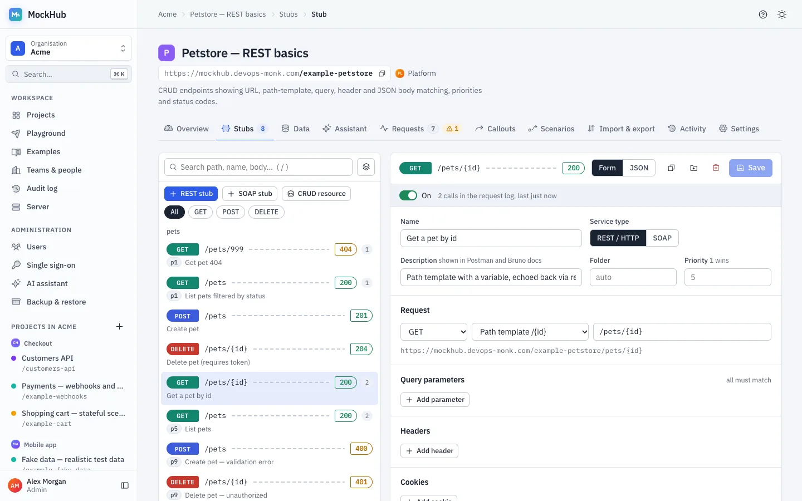
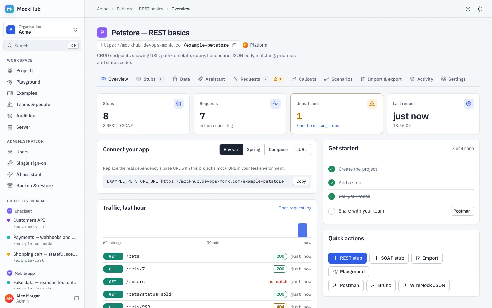
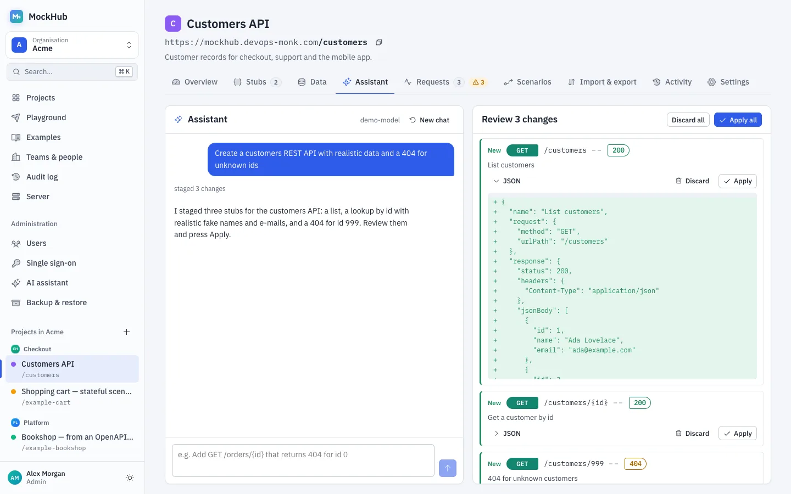
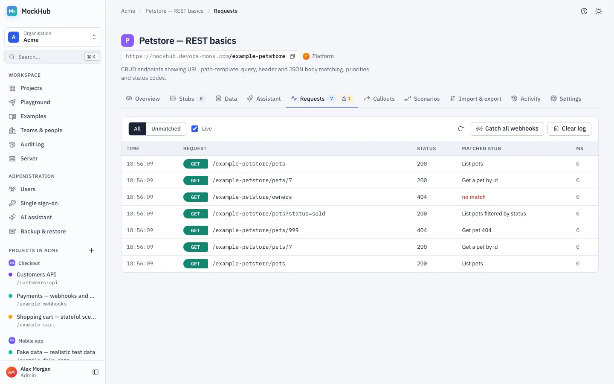
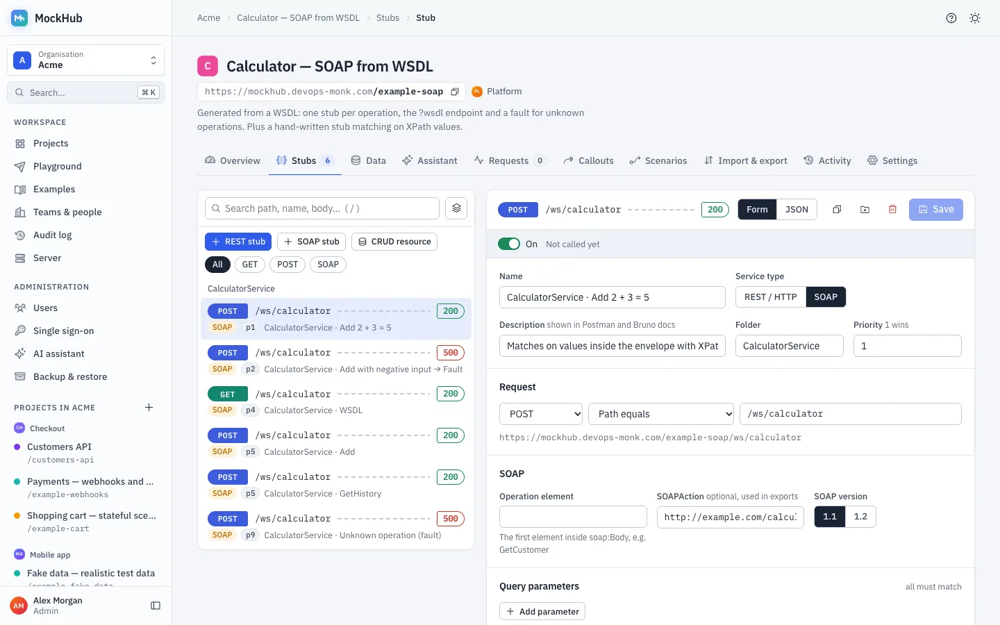
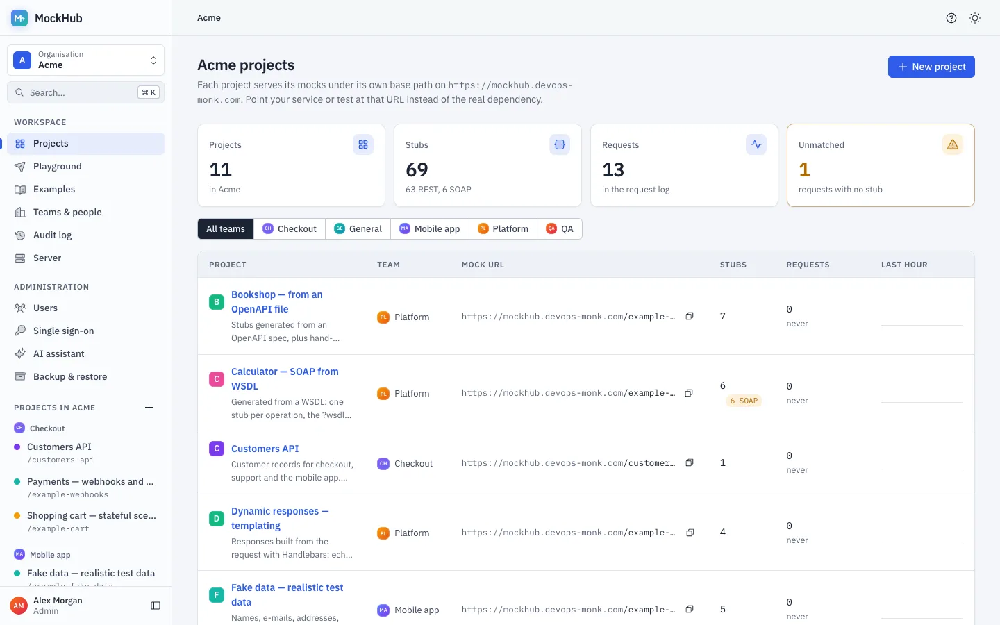
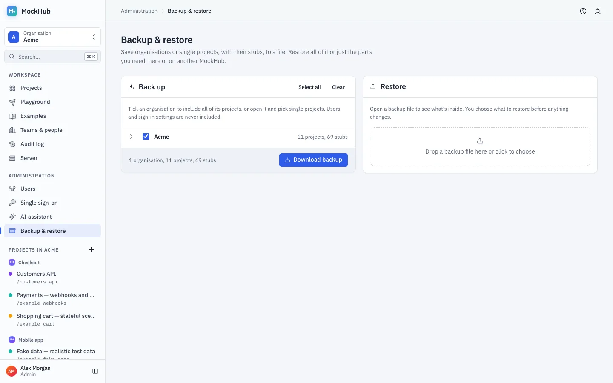
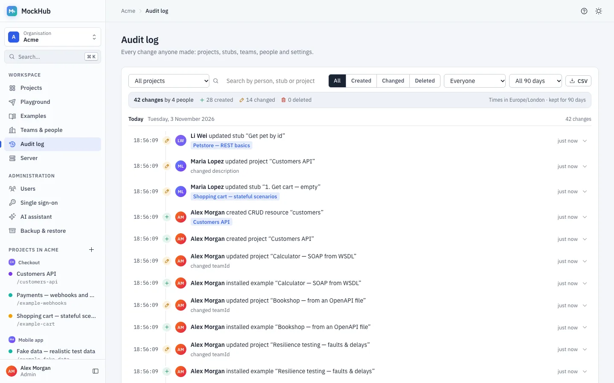
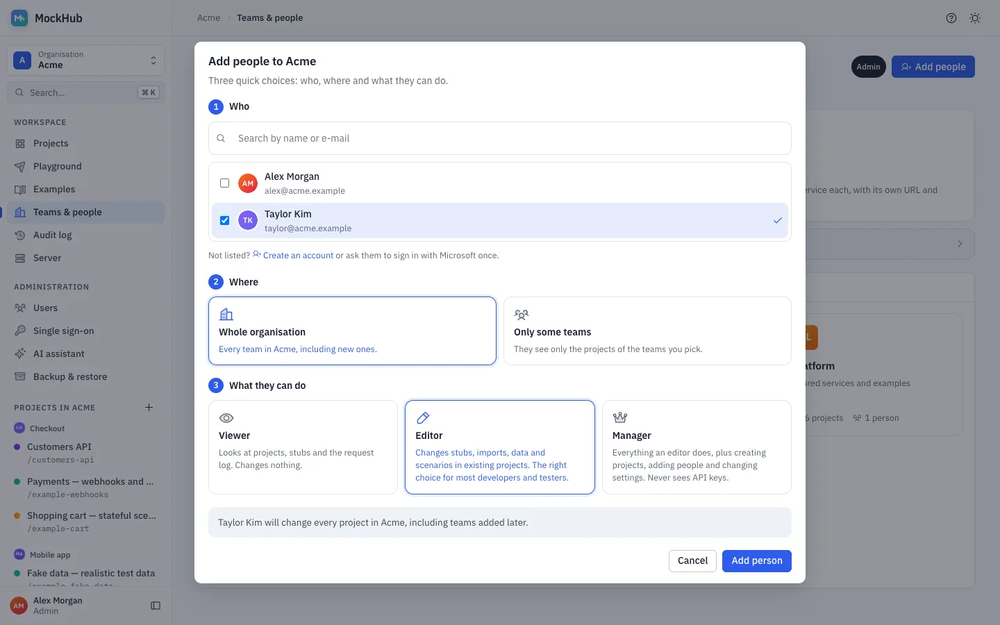

<p align="center">
  
</p>

<h1 align="center">MockHub</h1>

<p align="center">
  <strong>Every dependency. Mocked in minutes.</strong><br>
  A team mock server for REST, SOAP and GraphQL, built on WireMock, with a web UI, an AI assistant and one Docker image.
</p>

<p align="center">
  <a href="https://github.com/monk-developer-tools/mockhub/actions/workflows/ci.yml"></a>
  <a href="https://hub.docker.com/r/abhaypratap/mockhub"></a>
  <a href="https://hub.docker.com/r/abhaypratap/mockhub"></a>
  
  
</p>

<p align="center">
  <a href="https://mockhub.devops-monk.com/__admin/mockhub/ui/"><strong>Live demo</strong></a> &nbsp;·&nbsp;
  <a href="https://mockhub.devops-monk.com/tutorials/">Tutorials</a> &nbsp;·&nbsp;
  <a href="https://mockhub.devops-monk.com/docs/">Docs</a> &nbsp;·&nbsp;
  <a href="#quick-start">Quick start</a> &nbsp;·&nbsp;
  <a href="https://mockhub.devops-monk.com/">Website</a>
</p>

<picture>
  <source media="(prefers-color-scheme: dark)" srcset="website/assets/img/shots/editor-dark.webp">
  
</picture>

## Why MockHub

Developers and testers group mocks into **projects**. Each project gets its own URL, has a web UI for editing stubs,
and exports to **Postman** and **Bruno**. Everything is saved to disk, so mocks survive restarts and redeploys. It ships
as one JAR inside one small Docker image (about 115 MB, non-root, distroless), ready for Docker, Compose or AWS ECS.

```
https://mocks.acme.internal/__admin/mockhub/ui/          the UI
https://mocks.acme.internal/payment-service/...          mocks of project "Payment service"
https://mocks.acme.internal/legacy-crm/ws/customers      SOAP mocks of project "Legacy CRM"
```

## See it in action

<table>
  <tr>
    <td width="50%" valign="top">
      <strong>Everything about a service, on one screen</strong><br>
      Mock URL, a snippet to connect your app, last-hour traffic and one-click exports.<br><br>
<picture>
  <source media="(prefers-color-scheme: dark)" srcset="website/assets/img/shots/overview-dark.webp">
  
</picture>
    </td>
    <td width="50%" valign="top">
      <strong>Describe it, review it, apply it</strong><br>
      The AI assistant drafts stubs, and nothing goes live until you apply the diff.<br><br>
<picture>
  <source media="(prefers-color-scheme: dark)" srcset="website/assets/img/shots/assistant-dark.webp">
  
</picture>
    </td>
  </tr>
  <tr>
    <td width="50%" valign="top">
      <strong>Every call, searchable for days</strong><br>
      Live traffic with request rates, search by anything the caller sent, HAR export, and the closest stub for anything that didn't match.<br><br>
<picture>
  <source media="(prefers-color-scheme: dark)" srcset="website/assets/img/shots/requests-dark.webp">
  
</picture>
    </td>
    <td width="50%" valign="top">
      <strong>SOAP without the pain</strong><br>
      Import a WSDL and match on operations, or on any field with XPath.<br><br>
<picture>
  <source media="(prefers-color-scheme: dark)" srcset="website/assets/img/shots/soap-dark.webp">
  
</picture>
    </td>
  </tr>
  <tr>
    <td width="50%" valign="top">
      <strong>All your services at a glance</strong><br>
      Stub counts, unmatched requests and traffic for every project in your organisation.<br><br>
<picture>
  <source media="(prefers-color-scheme: dark)" srcset="website/assets/img/shots/dashboard-dark.webp">
  
</picture>
    </td>
    <td width="50%" valign="top">
      <strong>Back up exactly what you need</strong><br>
      Whole organisations or single projects, restored into any MockHub.<br><br>
<picture>
  <source media="(prefers-color-scheme: dark)" srcset="website/assets/img/shots/backup-dark.webp">
  
</picture>
    </td>
  </tr>
  <tr>
    <td width="50%" valign="top">
      <strong>Know who changed what, to the second</strong><br>
      Every change on a timeline, with filters, full details in local and UTC time, and a CSV download.<br><br>
<picture>
  <source media="(prefers-color-scheme: dark)" srcset="website/assets/img/shots/audit-dark.webp">
  
</picture>
    </td>
    <td width="50%" valign="top">
      <strong>Add people in three choices</strong><br>
      Who, where and what they can do, with the outcome in one plain sentence.<br><br>
<picture>
  <source media="(prefers-color-scheme: dark)" srcset="website/assets/img/shots/people-dark.webp">
  
</picture>
    </td>
  </tr>
</table>

New here? The [step-by-step tutorials](https://mockhub.devops-monk.com/tutorials/) walk through every feature with
screenshots, and the [live demo](https://mockhub.devops-monk.com/__admin/mockhub/ui/) runs the example projects.

## Features

- **Projects with their own base URL.** Point a service's config at `…/payment-service` instead of the real dependency.
- **Every WireMock feature.** URL, query, header, cookie and body matching (JSON, JSONPath, XML, XPath, regex),
  response templating, scenarios (stateful mocks), delays, faults, proxying and recording. The form editor covers
  the common cases, and the JSON editor takes anything WireMock accepts.
- **SOAP support.** A SOAP mode in the editor (operation matching, SOAP 1.1/1.2, envelope and fault helpers), plus
  **WSDL import**. Import creates one stub per operation with sample envelopes generated from the schema, serves
  `?wsdl` pointing at the mock, and adds a fault stub for operations that aren't mocked.
- **GraphQL from a schema.** Import SDL or an introspection result and one endpoint answers every query and mutation
  with realistic data in exactly the requested shape, echoing arguments such as ids and inputs. Fixed answers match an
  operation name and variables, and a GraphQL console runs example operations and saves answers as stubs.
- **Import** OpenAPI 3 / Swagger 2 (JSON or YAML), WSDL, GraphQL schemas, or WireMock mappings.
- **Move a whole WireMock repository.** Start MockHub on a copy of the folder, or import it as one zip (up to 20,000
  files): files with many stubs, `./` body file paths, folders and templated file names all keep working, and the stub
  that wins a tie stays the same after edits and restarts. See
  [Move a whole mock repository](https://mockhub.devops-monk.com/tutorials/#migrate-repo).
- **Export** a Postman v2.1 collection (with a status test per request), a Bruno collection, or WireMock mappings.
  A single `baseUrl` variable switches between the mock and the real service.
- **Try it.** Send a request to a stub from the editor and see the response. *Call it from your code* gives the
  same request as cURL, HTTPie, JavaScript, Python, Java, C# or Apex.
- **Playground.** Call your mocks or any public API from the server, see status, time, headers and a formatted body,
  keep a private history, replay requests from the log, and save any response as a stub.
- **Data generator.** Build a fixed JSON list (say 20 customers with names, e-mails and addresses) in one click, for
  response bodies or CRUD starting records.
- **Turn stubs on and off, and see what's used.** Pause a stub without deleting it. The stub list shows how many
  calls each stub answered and when it was last called.
- **Random failures.** Make a share of calls fail (say 10% with a 503, or a connection reset) to test retries.
- **API keys.** Require a header such as `X-API-Key` on every call to a project, like the real service would. Only admins see or change the key.
- **Request history** per project, kept on disk for days: search by text, method, status, header, stub and time, a live traffic chart with request rates, HAR export, near misses for unmatched requests and *create stub from request*.
- **CRUD resources with a data store.** One click gives you `/customers` with list (filter, sort, page), read,
  create, replace, patch and delete, backed by real stored records. A **Data** tab shows and edits the records, and
  they survive restarts and travel in backups.
- **Datasets.** Upload CSV, JSON or NDJSON test data once per organisation, with identity fields, indexes and
  replace, update-and-add or add-only uploads. Any stub answers from it with `{{dataset-one 'customers' id=request.path.id}}`
  or `{{dataset 'products' category='books'}}`. A Datasets page browses records and previews lookups, and the stub
  editor turns a JSON list body into a table you can edit or move into a dataset.
- **Connections and retries.** Store an OAuth2 client (client credentials) or an API key once per organisation,
  encrypted at rest. Webhooks, wait-for-callout and proxy stubs name the connection and MockHub fetches, caches and
  sends the token; logs show it masked. Callouts retry `429` and `5xx` answers with doubling waits, each attempt logged.
- **Recorded state.** Stubs remember data with the WireMock state extension's `recordState` and read it back with
  `{{state}}`, e.g. the items in a cart. State is kept per project on disk, travels in backups, and the **Data** tab
  shows each context to edit, delete or clear.
- **Realistic fake data.** `{{fake 'Name.fullName'}}`, `{{fake 'Internet.emailAddress'}}`, `{{fake 'Address.city'}}`
  and hundreds more in any templated response, in many languages. OpenAPI imports fill fields by name and format.
- **Webhooks and callouts.** A stub can call other services after it answers, like a payment callback. It can send a
  custom body built from the request and from the response it just sent, or forward the incoming request as is.
  **Wait for callout** goes further: the stub calls a partner while the caller waits, then answers with the partner's
  status, headers and body. The **Callouts** tab logs every call: what was sent, the answer, the time and any error.
  **Catch all webhooks** adds a receiver that answers 200 to anything, so you can point a third-party webhook at
  MockHub and inspect it. See [Webhooks and callouts](#webhooks-and-callouts).
- **Insert dynamic value.** Response and webhook bodies have a searchable menu of every template helper, grouped like
  request components, control flow, data manipulation, dates, arrays, state and Faker. A click inserts the helper at
  the cursor and turns templating on.
- **JWT, validation and weighted responses.** `{{jwt}}` signs RS256 or HS256 tokens with claims from the request,
  `{{{jwks}}}` publishes the public key and `{{jwtDecode}}` reads a bearer token, so a mock OAuth server takes three
  stubs. `{{required}}`, `{{isEmail}}`, `{{isUuid}}`, `{{isNumber}}` and `{{check}}` answer 400 (or your status) with a
  message when the request is wrong. A stub can answer with one of several responses by weight. Also `len`, `object`,
  `json`, `toNumber` and `default`. Every entry in the helper picker is rendered against a real server in CI.
- **Response files.** Upload PDFs, images or large JSON (up to 10 MB) and serve them as response bodies.
- **Built-in examples:** ten ready-made projects that cover every feature: REST matching, fake data, templating, real-world matching patterns, CRUD with saved data, stateful scenarios, webhooks, faults and failure rates, an OpenAPI import with response files, and a SOAP calculator from WSDL. The [tour of the examples](https://mockhub.devops-monk.com/tutorials/#tour) has commands to try with each.
  Install one with a click and copy what you need. The editor also has a template gallery.
- **Persistence.** Every stub, including ones created through the native `/__admin` API, is written to `/data`.
  Admins can back up everything, whole organisations or single projects to one file, and later restore all of it
  or just the projects they pick, replacing existing ones or adding copies, into the original or another organisation.
- **Snapshots.** Save a project's stubs, response files and runtime behaviour with a name and purpose, compare any
  snapshot with now as a stub-by-stub diff, and restore it after a safety snapshot of the current state. Pull one
  project into another (dev into qa) with URLs moved to the new base path, or move a snapshot between servers as a
  file. Records, history and secrets are never included.
- **AI assistant.** Connect OpenRouter, Hugging Face, a LiteLLM proxy or any OpenAI-compatible API, then describe the mocks you
  need in plain English or paste a spec. The assistant stages stubs, and you review each change as a diff before
  applying it. *Generate with AI* in the editor writes a single response body from a description.
- **MCP for coding agents.** Claude Code, Cursor, Codex and Claude Desktop connect to `/__admin/mockhub/mcp` with a
  personal access token and build, debug and tune mocks: stubs, matching order, CRUD data, delays and failures,
  callouts and request search. Each token applies changes directly or stages them for review.
- **Personal access tokens.** For scripts, CI and agents. Shown once and stored as a hash, with a name, expiry, role
  ceiling and project scope. Revocable, with the last use shown, and every change is audited with the token name.
- **Organisations, teams and people.** Organisations hold teams, and teams own projects. People get a role per team
  or across the whole organisation, and see only their teams' projects. Managers add people as viewers, editors or managers,
  and each person sees only their organisations.
- **Audit log.** Every create, change and delete with who did it, to the second. Filter by kind, person and date,
  open an entry for the full local and UTC time, and download it as CSV. Kept for 90 days and written to stdout.
- **Users and single sign-on.** Create users in the UI, or let people sign in with **Microsoft Entra ID** (Azure AD).
  Entra groups and app roles can map to organisation roles. Mock endpoints always stay open.
- **Free tools, no login.** At [mockhub.devops-monk.com/tools](https://mockhub.devops-monk.com/tools/): a webhook
  catcher, an HTTP echo, a response template playground, a fake data generator and an instant mock server (a
  mock URL kept for 7 days, started from sample stubs, an OpenAPI or WSDL file, CSV or JSON records or an example)
  run on the demo server (`MOCKHUB_PUBLIC_TOOLS`). A JWT encoder and decoder, cURL to stub and a stub JSON checker run in your browser.

## Quick start

```bash
docker run -p 8080:8080 -v mockhub-data:/data abhaypratap/mockhub
```

Open <http://localhost:8080/__admin/mockhub/ui/>, go to **Examples**, and install *Petstore — REST basics*. Then:

```bash
curl http://localhost:8080/example-petstore/pets/42
```

With Docker Compose: `docker compose up`.

## Configuration

All configuration is through environment variables.

| Variable | Default | Purpose |
|---|---|---|
| `PORT` | `8080` | HTTP port for UI, API and mocks |
| `MOCKHUB_DATA_DIR` | `/data` in Docker, `./mockhub-data` otherwise | Where projects, stubs and body files are stored. Mount a volume (EFS on ECS). |
| `MOCKHUB_PUBLIC_URL` | taken from the request | The URL people use to reach MockHub, e.g. `https://mocks.acme.internal`. Used in exports. |
| `MOCKHUB_USERS` | empty | Optional break-glass accounts: `user:password:role` entries separated by commas. Roles: `admin`, `editor`, `viewer` (server-wide). A password can be `sha256:<hex>`. |
| `MOCKHUB_AI_API_KEY` | empty | API key for the AI provider. Overrides the one saved in the UI. |
| `MOCKHUB_SSO_CLIENT_SECRET` | empty | Entra client secret. Overrides the one saved in the UI, so it can come from a secret store. |
| `MOCKHUB_LOGIN_NOTE` | empty | Text shown on the sign-in page, e.g. demo credentials |
| `MOCKHUB_JOURNAL_MAX_ENTRIES` | `5000` | How many requests WireMock's own journal keeps in memory (used for near-miss matching and the WireMock admin API) |
| `MOCKHUB_HISTORY_DAYS` | `7` | Days each project keeps its request and callout history on disk, searchable in the Requests tab |
| `MOCKHUB_HISTORY_MAX_MB` | `200` | Disk cap for one project's history; the oldest hours are dropped first |
| `MOCKHUB_AUDIT_RETENTION_DAYS` | `90` | Days the audit log keeps changes; older entries are deleted from disk |
| `MOCKHUB_LOG_LEVEL` | `info` | Detail written to standard output |
| `MOCKHUB_STUB_CORS` | `true` | CORS for projects that keep the server default: any website can call the mocks. Each project can set its own rules |
| `MOCKHUB_FAKE_LOCALE` | `en` | Default language for `{{fake ...}}` data, e.g. `de`, `fr`, `en-GB` |
| `MOCKHUB_PLAYGROUND_ALLOW_PRIVATE` | `false` | Let the Playground call private and local addresses (blocked by default so the server can't reach your internal network) |
| `MOCKHUB_CALLOUT_ALLOW_PRIVATE` | `false` | Let webhooks and *wait for callout* stubs call private and local addresses. Calls to MockHub's own mock URLs always work. Set it to `true` for callbacks to services on your own network, e.g. `host.docker.internal` |
| `MOCKHUB_MAX_RECORDS` | `10000` | Most records one CRUD resource keeps, and most state contexts one project keeps; the oldest go first. `0` keeps everything |
| `MOCKHUB_PUBLIC_TOOLS` | `false` | Turn on the no-login tools under `/__public/` (HTTP echo, webhook bins, template render, fake data, instant mocks) with per-address limits. Meant for a public demo; see [Public tools](https://mockhub.devops-monk.com/docs/config/#public-tools) |
| `WIREMOCK_OPTIONS` | empty | Any extra [WireMock CLI option](https://wiremock.org/docs/standalone/java-jar/), e.g. `--async-response-enabled true --verbose` |

## Webhooks and callouts

Many APIs answer at once and report the result later by calling you back: payment providers, shipping, KYC, async
jobs. MockHub mocks both sides of that.

**Then call (webhooks).** In a stub's *Then call* section, add one or more webhooks. Each one has a method, a URL, headers,
a body and a delay. The URL, headers and body are templates:

```json
"serveEventListeners": [{
  "name": "mockhub-callout",
  "parameters": {
    "method": "POST",
    "url": "{{jsonPath originalRequest.body '$.callbackUrl'}}",
    "headers": { "Content-Type": "application/json" },
    "body": "{ \"reference\": \"{{jsonPath originalRequest.body '$.reference'}}\", \"id\": \"{{jsonPath originalResponse.body '$.id'}}\", \"status\": \"SETTLED\" }",
    "delay": { "type": "fixed", "milliseconds": 2000 }
  }
}]
```

| In a webhook template | Means |
|---|---|
| `{{originalRequest.body}}`, `{{jsonPath originalRequest.body '$.x'}}`, `{{originalRequest.headers.X-Id}}`, `{{originalRequest.query.x}}`, `{{originalRequest.path.id}}`, `{{originalRequest.baseUrl}}` | the request that hit the stub |
| `{{originalResponse.body}}`, `{{jsonPath originalResponse.body '$.id'}}`, `{{originalResponse.status}}`, `{{originalResponse.headers.X}}` | the mock response the stub just sent |
| every other helper: `{{now}}`, `{{randomValue type='UUID'}}`, `{{fake 'Name.fullName'}}`, `#if`, `#each` … | as in response templating |

Pick **Forward incoming request** (`"forward": true`) to send the request as it arrived (method, headers, body) instead
of a custom body. Headers you add are put on top.

**Wait for callout.** Choose *Wait for callout* as the response type. MockHub calls the URL while the caller waits,
then answers with the target's status, headers and body. Use it to put a mock in front of a real or mocked partner and
reshape the request on the way. If the call fails, the caller gets `502` with the reason, and the header
`X-MockHub-Callout-Error: true`.

```json
"response": {
  "status": 200,
  "transformers": ["mockhub-sync-callout"],
  "transformerParameters": { "callout": { "method": "POST", "url": "https://issuer.example.com/authorize",
    "headers": { "Content-Type": "application/json" }, "body": "{ \"pan\": \"{{jsonPath originalRequest.body '$.card'}}\" }" } }
}
```

**Callouts tab.** Every webhook and wait-for-callout call shows up with its target, what was sent, the answer, the
time it took and any error, such as a template mistake, a refused connection or a blocked address. It updates live.

**Catch all webhooks.** On the Requests tab, *Catch all webhooks* adds a low-priority stub that answers `200` to any
request no other stub matched. Give a third-party service `<mock URL>/webhooks` (or any path) and watch its calls
arrive in the request history.

**Where callouts may go.** Calls to MockHub's own mock URLs always work, including relative URLs like
`/payments/partner/callbacks`. Private and local addresses (`10.x`, `192.168.x`, `localhost` services other than
MockHub, cloud metadata) are blocked unless an admin sets `MOCKHUB_CALLOUT_ALLOW_PRIVATE=true`. MockHub's admin API can't
be called.

**WireMock compatibility.** WireMock's own `webhook` listener still works, and the editor opens it. When you save, it's
stored as `mockhub-callout` so it shows up in the Callouts tab. The *WireMock mappings* export turns `mockhub-callout`
back into `webhook` for plain WireMock. Wait-for-callout is MockHub-only.

The [Payments — webhooks and callbacks](https://mockhub.devops-monk.com/tutorials/#tour) example shows all of this.

## Organisations, users and sign-in

Sign-in is off until there is a user. While it's off, anyone who can reach MockHub can change everything. To turn it
on, either open **Users** in the UI and create the first admin, or start with a break-glass admin:

```bash
docker run -p 8080:8080 -v mockhub-data:/data \
  -e MOCKHUB_USERS="root:change-me:admin" \
  -e MOCKHUB_PUBLIC_URL=https://mocks.acme.internal \
  abhaypratap/mockhub
```

MockHub has three levels: **organisation › teams › people**.

- **Organisations** group everything. On first start, MockHub creates one called *Default*. Admins create more from
  the organisation switcher at the top of the sidebar.
- **Teams** live inside an organisation and own its projects. Every organisation has a *General* team; projects from
  before teams existed move there on startup. Organisation managers create more teams under **Teams & members**.
- **People** get a role per team, an organisation-wide role that applies to every team, or both. The higher role
  wins. Team members only see their own teams' projects.

| Role | In a team | Organisation-wide |
|---|---|---|
| viewer | see the team's projects, stubs and request logs, and download exports | the same, in every team |
| editor | also add, change and delete stubs, import, record, and edit data and scenarios | the same, in every team |
| manager | also create, rename, move and delete projects, and manage the team's members | also create and delete teams, manage members and the organisation |
| admin (server role) | everything | also create organisations, and see and change every secret |

**Secrets stay with admins.** Only admins create organisations, see or change a project's API key, and configure the
AI assistant, single sign-on and backups. Everyone else sees *X-API-Key · set*; Try it, code snippets and Postman /
Bruno exports use a `{{apiKey}}` placeholder instead of the key. Existing *owner* memberships and SSO mappings become
*manager* automatically.

A team can only be deleted once its projects are moved or deleted. Mock URLs don't change when a project moves between
teams or organisations, and base paths stay unique across the server. Admins set organisation and team roles for
anyone from **Users**, and Entra groups can map to a whole organisation or to a single team.

Each user also has a **server role**. With *viewer everywhere* or *editor everywhere*, a user has that role in every
organisation. With *admin*, a user also manages users, single sign-on, backups and the native WireMock admin API.
Users from `MOCKHUB_USERS` keep the role given there. Use them as a break-glass account.

The UI keeps a session token for 12 hours. Scripts and CI should use a **personal access token** (Account → Access
tokens) as `Authorization: Bearer mh_…`; HTTP Basic auth with a username and password still works. A token never has
more access than its owner, can be limited to a role and to chosen projects, and expires after 7, 30, 90 or 365 days
or never. MockHub stores only its SHA-256 hash.
Changing a password or disabling a user signs out that user's other sessions.

### Single sign-on with Microsoft Entra ID

1. In the [Entra admin centre](https://entra.microsoft.com), go to **App registrations → New registration**. Choose
   **Web** as the redirect URI type and paste the redirect URI from **MockHub → Single sign-on**:
   `https://<your MockHub>/__admin/mockhub/api/auth/sso/azure/callback`.
2. Copy the **Application (client) ID** and the **Directory (tenant) ID**.
3. Under **Certificates & secrets**, create a client secret and copy its value.
4. Optional: to use groups, add a **groups claim** under **Token configuration**, or define **App roles**.
5. In MockHub, paste the three values and choose **Test connection**. Then pick:
   - the allowed e-mail domains
   - the organisation and role every new user gets
   - mappings from group object IDs or app role values to organisation roles or a server role

   Turn it on and save.

The login page then shows **Sign in with Microsoft**. MockHub uses the authorisation code flow with PKCE. It checks
the ID token's signature against the tenant's keys, and checks the issuer, audience, expiry and nonce. People are
created on their first sign-in. Roles that come from groups are refreshed at every sign-in. Roles you set by hand
in the UI are kept.

Set `MOCKHUB_PUBLIC_URL` when MockHub runs behind a proxy, so the redirect URI matches what you registered. Use
**Also allow MockHub passwords** to make SSO the only way in for everyone except admins.

## AI assistant

An admin connects a model under **Administration → AI assistant**:

| Provider | Base URL | Notes |
|---|---|---|
| OpenRouter | `https://openrouter.ai/api/v1` (default) | One key for hundreds of models. `openrouter/auto` picks one, or name a model that supports tool calling. |
| Hugging Face | `https://router.huggingface.co/v1` | Open models through Inference Providers. Use a token with "Make calls to Inference Providers" and a model with tool calling, e.g. `openai/gpt-oss-120b`. |
| LiteLLM proxy | e.g. `http://litellm:4000` | Uses your proxy's virtual keys, budgets, logging and approved models. The model is the proxy's `model_name`. |
| Other OpenAI-compatible | e.g. `https://api.openai.com/v1` | OpenAI, Azure OpenAI, Ollama, vLLM, LM Studio and others. |

Then, in any project, open **Assistant** and say what you need. For example:

- *Payments API: POST /payments creates a payment, GET /payments/{id} returns it, 404 for unknown ids*
- *Create stubs for the requests that matched nothing*
- *Make every POST answer after 2 seconds*
- *Add a SOAP GetCustomer operation*
- *After POST /payments, call the callbackUrl from the request 2 seconds later with status SETTLED*
- *Why are my webhooks failing? Check the recent callouts and fix them*

You can also paste an OpenAPI spec, a WSDL or curl commands. The new-project dialog has a **Describe the API** box
that starts the conversation for you.

The stub editor's *Then call* section has an **Ask the assistant** box for describing a webhook in words, and the
Callouts tab has **Ask the assistant to fix it** on any failed callout.

The assistant uses tool calling. It reads the project's stubs, searches the request history and reads recent callouts, and it **stages** creates,
updates and deletes. Each staged change appears as a diff. You apply or discard each one, so nothing changes until
someone with the editor role applies it. Viewers can draft changes but can't apply them. Request and callout
contents are treated as data, not instructions.

The conversation, the project's stubs and, when the assistant asks for them, recent requests are sent to the
provider you configure. Choose one your organisation allows, or run models yourself behind LiteLLM.

## MCP for coding agents

MockHub is an MCP server at `/__admin/mockhub/mcp` (Streamable HTTP, stateless JSON answers). Create a token under
**Account → Access tokens**; the dialog shows the setup for each client with your URL and token filled in.

```bash
# Claude Code
claude mcp add --transport http mockhub https://mockhub.example.com/__admin/mockhub/mcp \
  --header "Authorization: Bearer mh_…"
```

```json
// Cursor: .cursor/mcp.json
{ "mcpServers": { "mockhub": { "url": "https://mockhub.example.com/__admin/mockhub/mcp",
  "headers": { "Authorization": "Bearer mh_…" } } } }
```

```toml
# Codex: ~/.codex/config.toml, with the token in MOCKHUB_TOKEN
[mcp_servers.mockhub]
url = "https://mockhub.example.com/__admin/mockhub/mcp"
bearer_token_env_var = "MOCKHUB_TOKEN"
```

Claude Desktop connects through `npx -y mcp-remote <url> --header "Authorization: Bearer mh_…"`.

Tools: `list_projects`, `get_project`, `get_stub_reference`, `list_stubs`, `get_stub`, `create_stub`, `update_stub`,
`delete_stub`, `set_stub_enabled`, `reorder_stubs`, `get_runtime`, `set_runtime`, `search_requests`, `get_request`,
`clear_requests`, `list_callouts`, `list_data`, `create_crud_resource`, `list_records`, `save_record`,
`delete_record`, `list_snapshots`, `create_snapshot`, `compare_snapshots`, `restore_snapshot`, `pull_from_project`
and `list_staged_changes`. They call the same API as the UI, so validation, roles and the audit log
all apply. A token set to *stage for review* puts stub, runtime, snapshot and restore changes in the project's Assistant tab for an
editor to apply, and can't make other changes. Requests from a browser page on another origin are refused.

Try: *“Which requests to Checkout found no stub in the last hour? Create stubs for them.”* or *“Make Payments 1.5 s
slower and fail 5% of calls with 503.”*

## How it works

MockHub is a WireMock extension running inside a regular WireMock server:

- Mocks are plain WireMock stubs. A project is a base path plus a tag (`metadata.mockhub.projectId`) on its stubs.
  The UI edits paths relative to the project. A stub listener marks every stub persistent, so WireMock writes it to
  `/data/mappings`.
- Projects, organisations, users and SSO settings are stored as JSON in `/data/mockhub/`. Passwords are PBKDF2
  hashes. `secret.key` signs session tokens, so keep it, and back up `/data` as a whole.
- The UI is served from the JAR at `/__admin/mockhub/ui/`, and the MockHub API at `/__admin/mockhub/api/`. The
  native WireMock admin API stays available at `/__admin/`.

### MockHub API

| Method | Path | |
|---|---|---|
| POST | `/__admin/mockhub/api/auth/login` | `{username, password}` → session token |
| GET | `/__admin/mockhub/api/auth/me` | the signed-in user and their organisations |
| GET/POST | `/__admin/mockhub/api/auth/tokens` | your access tokens / create one (`{name, role, projectIds, mode, expiresInDays}`, answer has `secret`) |
| DELETE | `/__admin/mockhub/api/auth/tokens/{tokenId}` | revoke a token |
| GET | `/__admin/mockhub/api/projects/{id}/staged` | changes staged by review tokens |
| POST | `/__admin/mockhub/api/projects/{id}/staged/apply` | apply staged changes (`{ids}`); `DELETE …/staged/{changeId}` discards one |
| POST | `/__admin/mockhub/mcp` | MCP server (JSON-RPC over Streamable HTTP) |
| GET/POST | `/__admin/mockhub/api/orgs` | list / create organisations |
| GET/PUT/DELETE | `/__admin/mockhub/api/orgs/{id}` | read / rename / delete an organisation (and its projects) |
| GET | `/__admin/mockhub/api/orgs/{id}/members` | members with their roles |
| PUT/DELETE | `/__admin/mockhub/api/orgs/{id}/members/{userId}` | add or change (`{role}`) / remove organisation-wide access |
| GET/POST | `/__admin/mockhub/api/orgs/{id}/teams` | list / create teams (`{name, description}`) |
| GET/PUT/DELETE | `/__admin/mockhub/api/orgs/{id}/teams/{teamId}` | read / rename / delete a team (only when it has no projects) |
| GET | `/__admin/mockhub/api/orgs/{id}/teams/{teamId}/members` | team members, plus people with organisation-wide access |
| PUT/DELETE | `/__admin/mockhub/api/orgs/{id}/teams/{teamId}/members/{userId}` | add or change (`{role}`) / remove a team member |
| GET/POST | `/__admin/mockhub/api/users` | list / create users (admin) |
| PUT/DELETE | `/__admin/mockhub/api/users/{id}` | update / delete a user; `POST …/password` resets it |
| GET/PUT | `/__admin/mockhub/api/sso` | single sign-on settings (admin); `POST /sso/test` checks the tenant |
| GET/POST | `/__admin/mockhub/api/projects?orgId=` | list / create projects (`orgId` in the body) |
| GET/PUT/DELETE | `/__admin/mockhub/api/projects/{id}` | read / update / delete a project (and its stubs) |
| GET/POST | `/__admin/mockhub/api/projects/{id}/stubs` | list / create stubs (project-relative URLs) |
| GET/PUT/DELETE | `/__admin/mockhub/api/projects/{id}/stubs/{stubId}` | read / update / delete a stub |
| POST | `/__admin/mockhub/api/projects/{id}/stubs/{stubId}/clone?target=` | copy a stub |
| POST | `/__admin/mockhub/api/projects/{id}/stubs/{stubId}/move?target=` | move a stub to another project |
| PUT | `/__admin/mockhub/api/projects/{id}/stubs/{stubId}/enabled` | `{enabled}` → turn a stub on or off |
| GET | `/__admin/mockhub/api/projects/{id}/usage` | calls and last call time per stub, from the request log |
| GET/POST | `/__admin/mockhub/api/projects/{id}/snapshots` | list / take a snapshot (`{name, purpose}`) |
| GET/DELETE | `/__admin/mockhub/api/projects/{id}/snapshots/{snapshotId}` | read / delete a snapshot; `GET …/download` saves it as a file |
| GET | `/__admin/mockhub/api/projects/{id}/snapshots/compare?from=&to=current` | stub, file and runtime diff between two snapshots or a snapshot and now |
| POST | `/__admin/mockhub/api/projects/{id}/snapshots/{snapshotId}/restore` | restore, after saving a safety snapshot |
| POST | `/__admin/mockhub/api/projects/{id}/snapshots/upload` | add a downloaded snapshot file |
| GET/POST | `/__admin/mockhub/api/projects/{id}/pull` | `GET …/pull/preview?from=&snapshot=` shows the change; `POST {from, snapshot}` pulls another project in |
| GET/DELETE | `/__admin/mockhub/api/projects/{id}/requests?unmatched=&limit=` | WireMock's in-memory journal; DELETE also clears the project's history |
| GET | `/__admin/mockhub/api/projects/{id}/history?q=&method=&status=&matched=&stub=&header=&from=&to=&limit=&offset=` | search the request history; returns items, total and facets |
| GET | `/__admin/mockhub/api/projects/{id}/history/{entryId}` | one request with headers, bodies and the callouts it triggered |
| GET | `/__admin/mockhub/api/projects/{id}/history-export?…` | the same filters, as a HAR 1.2 download (up to 500 requests) |
| GET | `/__admin/mockhub/api/projects/{id}/traffic?window=5m\|15m\|1h\|6h\|24h` | request counts per bucket with average and peak requests per second |
| GET | `/__admin/mockhub/api/projects/{id}/traffic/daily` | requests and unmatched requests per day for the last 30 days |
| GET/DELETE | `/__admin/mockhub/api/projects/{id}/callouts?limit=` | callout log: webhooks and *wait for callout* calls with what was sent, the answer, timing and errors |
| GET | `/__admin/mockhub/api/projects/{id}/export/{postman,bruno,wiremock}` | download an export |
| POST | `/__admin/mockhub/api/projects/{id}/import/{openapi,wsdl,graphql,wiremock}` | import a document (request body); GraphQL takes `?path=&name=` |
| POST | `/__admin/mockhub/api/projects/{id}/graphql/operations` | example operations for `{schema}` (viewers too) |
| GET/POST | `/__admin/mockhub/api/examples`, `/examples/{id}/install` | built-in examples |
| GET | `/__admin/mockhub/api/stubs/unassigned` | stubs not in any project |
| POST | `/__admin/mockhub/api/projects/{id}/adopt/{stubId}?prefix=` | put such a stub into a project |
| POST | `/__admin/mockhub/api/projects/{id}/ai/chat` | `{messages, pending}` → reply plus staged changes (waits for the model) |
| POST | `/__admin/mockhub/api/projects/{id}/ai/jobs` | Same body; starts the chat in the background and returns a job id |
| GET | `/__admin/mockhub/api/projects/{id}/ai/jobs/{jobId}` | Job status, live steps, then the reply or error (kept 30 minutes, visible to whoever started it) |
| POST | `/__admin/mockhub/api/projects/{id}/ai/apply` | `{changes}` → apply staged changes (editor) |
| POST | `/__admin/mockhub/api/playground/send` | `{method, url, headers, body}` → response and history entry (editor) |
| GET/DELETE | `/__admin/mockhub/api/playground/history`, `…/history/{entryId}` | your Playground history / clear it / delete one entry |
| POST | `/__admin/mockhub/api/fake/generate` | `{count, fields: [{name, expression}], locale}` → generated records |
| POST | `/__admin/mockhub/api/projects/{id}/ai/body` | `{description, format, method, path, status, current}` → a generated body (editor) |
| POST | `/__admin/mockhub/api/projects/{id}/crud` | `{resource, idField, idType: number\|uuid\|short, seed}` → create a CRUD resource |
| GET/DELETE | `/__admin/mockhub/api/projects/{id}/data` | resources with record counts / delete all records |
| GET/POST/PUT/DELETE | `/__admin/mockhub/api/projects/{id}/data/records?resource=&id=` | list, add, replace, delete one, or clear a resource |
| GET/POST | `/__admin/mockhub/api/orgs/{id}/datasets` | datasets and limits / create `{key, name, identity, indexes}` (organisation editor) |
| GET/PUT/DELETE | `/__admin/mockhub/api/orgs/{id}/datasets/{key}` | one dataset / change settings / delete |
| POST | `/__admin/mockhub/api/orgs/{id}/datasets/{key}/upload?format=csv\|json\|ndjson&mode=replace\|upsert\|add` | upload the file as the body |
| GET | `/__admin/mockhub/api/orgs/{id}/datasets/{key}/records?field=value&q=&offset=&limit=` | records, filtered or searched |
| GET/POST | `/__admin/mockhub/api/orgs/{id}/connections` | connections without secrets / create `{key, name, type: oauth2\|header, tokenUrl, clientId, scope, audience, clientAuth, headerName, headerPrefix, secret}` (organisation manager) |
| GET/PUT/DELETE | `/__admin/mockhub/api/orgs/{id}/connections/{key}` | one connection / change (empty secret keeps the saved one) / delete |
| POST | `/__admin/mockhub/api/orgs/{id}/connections/{key}/test` | fetch a fresh token and return a masked preview |
| GET/DELETE | `/__admin/mockhub/api/projects/{id}/state` | recorded state contexts / delete all of them |
| PUT/DELETE | `/__admin/mockhub/api/projects/{id}/state/context?name=` | `{properties, list}` → set a context / delete one |
| GET/POST/DELETE | `/__admin/mockhub/api/projects/{id}/files?name=` | list / upload (raw body) / delete response files |
| GET | `/__admin/mockhub/api/projects/{id}/files/content?name=` | download a response file |
| GET/PUT | `/__admin/mockhub/api/ai/settings` | AI provider settings (admin); `POST /ai/test` lists models |
| GET | `/__admin/mockhub/api/backup` | everything as one JSON file (admin) |
| POST | `/__admin/mockhub/api/backup` | `{organizations:[ids], projects:[ids]}` or `{everything:true}` → backup of just that (admin) |
| POST | `/__admin/mockhub/api/restore/preview` | backup file → organisations and projects inside, and what each would do here (admin) |
| POST | `/__admin/mockhub/api/restore` | `{backup, organizations, projects, targetOrgId?, mode: replace\|copy}`, or a bare backup file to restore all of it (admin) |

Example: a CI job that loads mocks before running tests.

```bash
curl -X POST "$MOCKHUB/__admin/mockhub/api/projects/$PROJECT/import/openapi" --data-binary @openapi.yaml
```

## Deploying to AWS ECS

`deploy/terraform` is a tested Terraform module for Fargate (ARM64 or x86), an EFS volume for `/data`, and an ALB
with optional HTTPS. See [docs/DEPLOYMENT-AWS.md](docs/DEPLOYMENT-AWS.md).

All logs go to standard output with UTC timestamps, so the `awslogs` driver ships them to CloudWatch: startup,
audit entries (`INFO audit`), sign-ins and failed sign-ins, refused requests and errors with stack traces. Add
`--verbose` to `WIREMOCK_OPTIONS` to log every mock request as well. On your own ECS setup, point the health check at
`/__admin/health`, mount `/data` on EFS and run a single task.

```bash
cd deploy/terraform && cp terraform.tfvars.example terraform.tfvars && terraform init && terraform apply
```

## Development

Requirements: JDK 17+ and Node 20+.

```bash
make build          # UI + fat JAR + all tests -> build/libs/mockhub.jar
make run            # run it on :8080 with ./mockhub-data
make ui-dev         # Vite dev server on :5173, proxying the API to :8080
make test           # Java unit, integration and system tests + UI tests
make docker         # build abhaypratap/mockhub locally
```

Gradle tasks: `unitTest`, `integrationTest` (in-process server), `systemTest` (runs the packaged JAR as a process,
including a restart), `uiTest`, and `test` for all the Java levels.

Screenshots for reviewing UI changes and refreshing the website:

```bash
node ui/scripts/demo.mjs http://localhost:8080      # on a fresh server: seeds the "Acme" demo (sign-in on, user alex)
MOCKHUB_USER=alex MOCKHUB_PASSWORD=demo-password-1 \
  npm --prefix ui run screens -- http://localhost:8080 screens   # key pages, light and dark, desktop and phone
```

The website is generated. Edit the docs pages in `website/docs-src/pages/` and the sidebar in `website/docs-src/docs.mjs`.
Feature pages, the menus, the footer and the free tools come from `website/site-src/pages.mjs`. Then build (needs
Node 22.6+ and `ui/node_modules`; `deploy/vps/deploy-site.sh` runs it too). The build fails on a broken internal link,
a missing image or an image without alt text:

```bash
node --disable-warning=ExperimentalWarning website/scripts/build-site.mjs
node --test website/tests/*.test.mjs                  # the free tools' logic, comparison data and preview cards
```

Every page has its own social preview card (1200×630) in `website/assets/img/og/`, drawn from its title. After adding a
page or changing a title, regenerate them with Chrome installed (set `CHROME_PATH` if it is not in the default macOS
place) and commit the images. The tests fail if a page has no card:

```bash
node --disable-warning=ExperimentalWarning website/scripts/build-og.mjs
```

### Code layout

```
src/main/java/io/mockhub
  Main, Config, HealthCheck      entry points and env configuration
  ext/                           WireMock extensions: factory (composition root), admin API, auth, persistence
  api/                           tiny router, request context, JSON helpers
  controller/                    one controller per resource
  project/                       projects: model, repository port + file implementation, service, listener
  org/ user/                     organisations and users: models, repository ports + file implementations, services
  auth/                          roles, principal, session tokens, access policy
  sso/                           single sign-on: provider strategy (Entra ID), OIDC token check, role mapping
  ai/                            AI assistant: provider strategy (OpenRouter, Hugging Face, LiteLLM, OpenAI-compatible), tool loop, staged changes
  token/                         personal access tokens: model, repository port + file implementation, service
  mcp/                           MCP server: JSON-RPC transport, tools over the internal API, review stager
  template/                      template helpers (values, validation, JWT) and weighted responses
  snapshot/                      snapshots: model, repository port + file implementation, diff, file format, service
  stub/                          project stubs: gateway port to WireMock, path re-rooting, metadata
  journal/                       request log per project
  callout/                       webhooks and wait-for-callout: listener, transformer, templating, target guard, log
  importer/ export/ soap/        import and export strategies, WSDL/XSD sampling
  example/                       bundled example catalog and installer
ui/src
  api/ model/ state/             API client, stub form model, app state
  components/ pages/             UI
website
  docs-src/                      docs pages, docs sidebar, shared header and footer
  site-src/                      feature and tool pages as data, page renderer, tool markup
  assets/js/tools/               the free tools: pure logic modules plus one page script each
  scripts/build-site.mjs         builds docs, feature pages, sitemap and checks every link
  scripts/build-og.mjs           draws each page's social preview card with headless Chrome
```

### Releasing

Pushes to `main` publish `abhaypratap/mockhub:latest`. A tag `vX.Y.Z` publishes `X.Y.Z` and `X.Y`. Images are
multi-arch (amd64 and arm64). The pipeline needs two repository secrets: `DOCKERHUB_USERNAME` and `DOCKERHUB_TOKEN`
(a Docker Hub access token with read and write access).

## Security updates

- The image is built on `distroless/base-nossl`, which has no OpenSSL: Java brings its own TLS and certificates.
  It is rebuilt every Monday, and on every push to `main`, from the latest base, so operating system fixes arrive
  without a code change.
- WireMock runs on Jetty 12 through `org.wiremock:wiremock-jetty12`, because Jetty 11 no longer gets fixes.
- `build.gradle.kts` pins patched versions of libraries that WireMock pulls in (Jackson, Apache HttpComponents,
  Handlebars, commons-lang3). Only the core Handlebars jar is upgraded: `handlebars-helpers` stays on 4.3.1, because
  newer versions moved classes that WireMock 3 loads.

## Limits

- Run **one** task per data directory. WireMock keeps stubs in memory and only reads the files at startup, so two
  replicas would drift apart. One task handles thousands of requests per second, which is plenty for test environments.
- Scenario states and rate-limit counters live in memory and reset on restart. Recorded state is saved on disk. A CRUD resource keeps up to `MOCKHUB_MAX_RECORDS` (10,000) records and drops the oldest past that. Request and callout history is kept on disk for `MOCKHUB_HISTORY_DAYS` days and is not part of backups.
- A webhook is sent once. Failed callouts are logged but not retried.

## Licence

MockHub is open source under the [Apache License 2.0](LICENSE). It is built on [WireMock](https://wiremock.org), which
uses the same licence, and is not affiliated with WireMock Inc.
