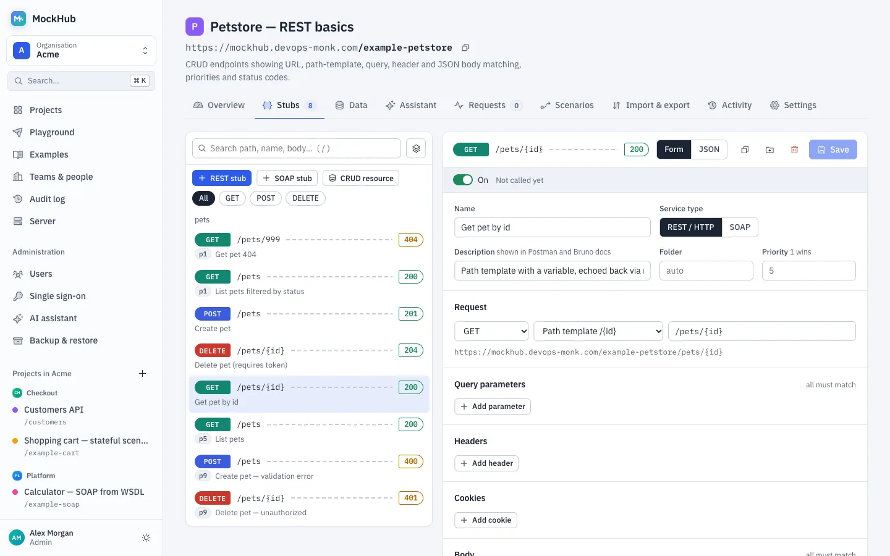
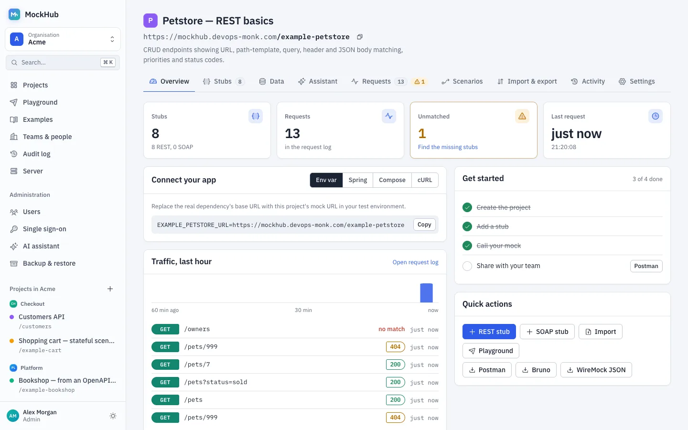
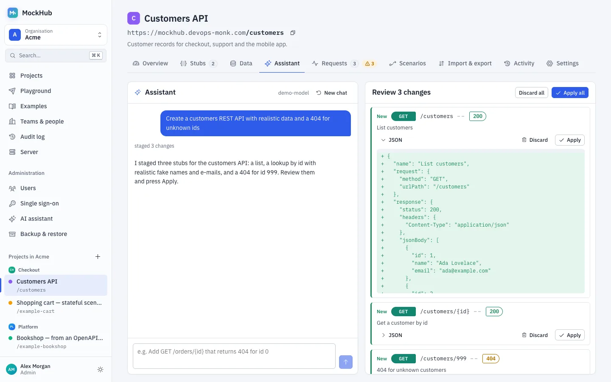
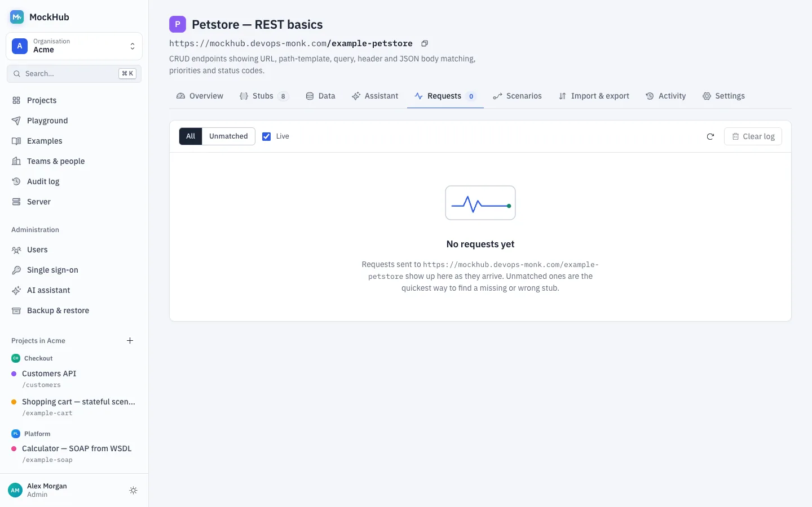
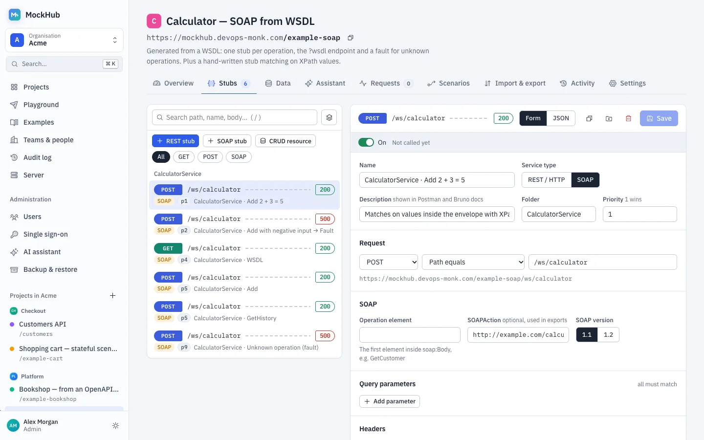
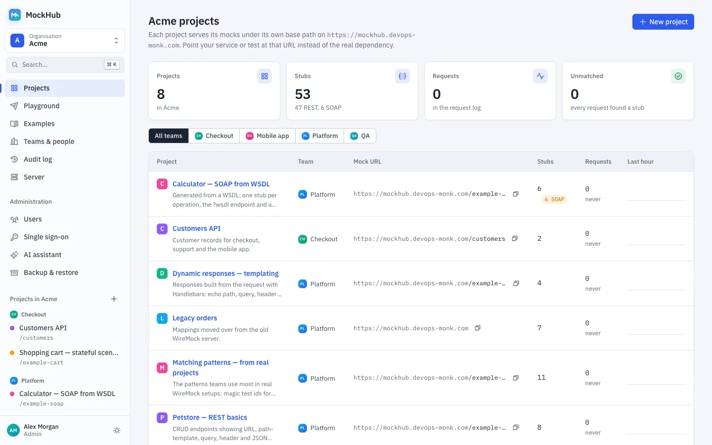
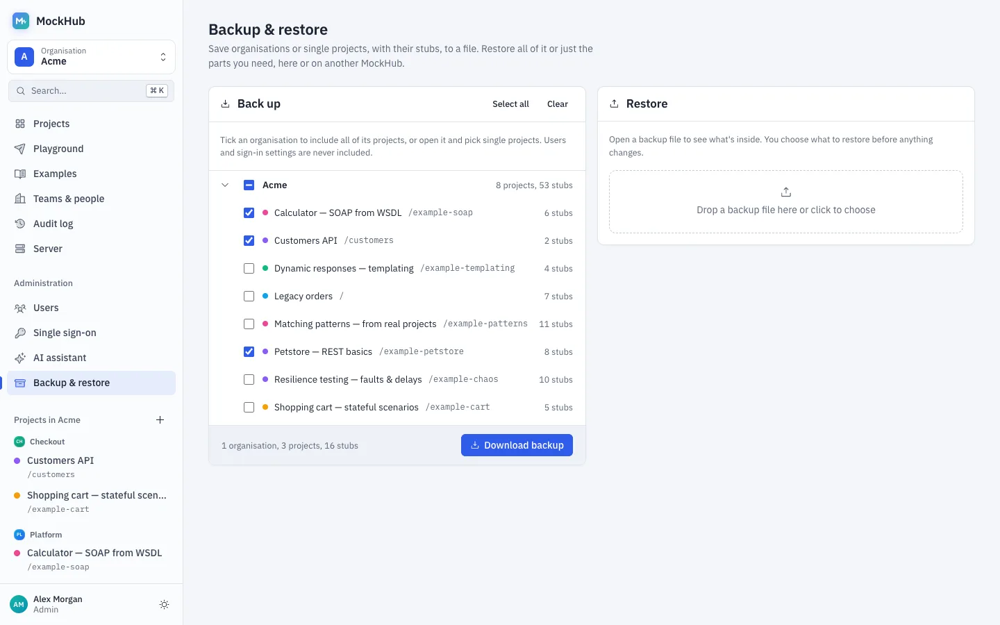
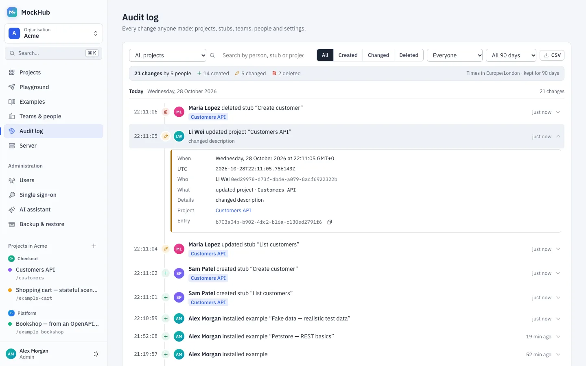
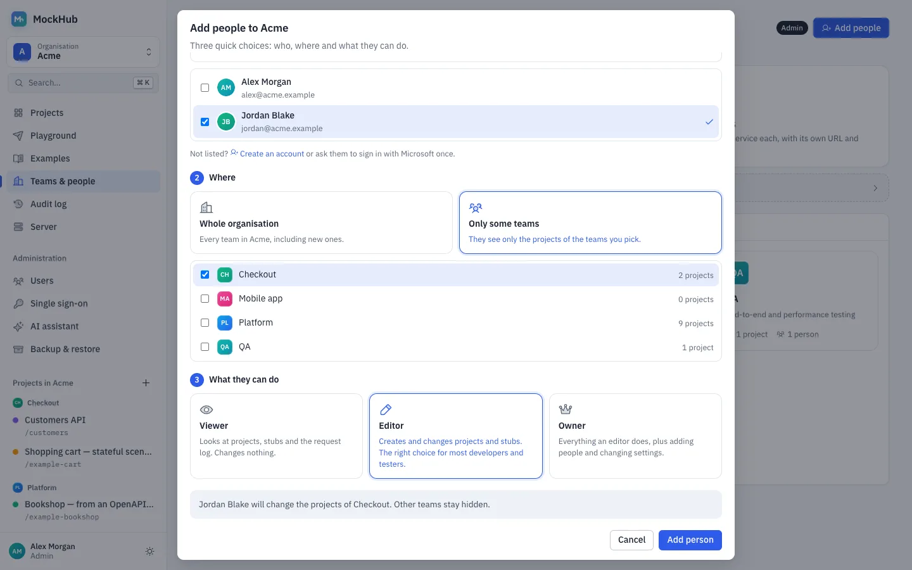

<p align="center">
  
</p>

<h1 align="center">MockHub</h1>

<p align="center">
  <strong>Every dependency. Mocked in minutes.</strong><br>
  A team mock server for REST and SOAP, built on WireMock, with a web UI, an AI assistant and one Docker image.
</p>

<p align="center">
  <a href="https://github.com/monk-developer-tools/mockhub/actions/workflows/ci.yml"></a>
  <a href="https://hub.docker.com/r/abhaypratap/mockhub"></a>
  <a href="https://hub.docker.com/r/abhaypratap/mockhub"></a>
  
  
</p>

<p align="center">
  <a href="https://mockhub.devops-monk.com/__admin/mockhub/ui/"><strong>Live demo</strong></a> &nbsp;·&nbsp;
  <a href="https://mockhub.devops-monk.com/tutorials/">Tutorials</a> &nbsp;·&nbsp;
  <a href="https://mockhub.devops-monk.com/docs/">Docs</a> &nbsp;·&nbsp;
  <a href="#quick-start">Quick start</a> &nbsp;·&nbsp;
  <a href="https://mockhub.devops-monk.com/">Website</a>
</p>

<picture>
  <source media="(prefers-color-scheme: dark)" srcset="website/assets/img/shots/editor-dark.webp">
  
</picture>

## Why MockHub

Developers and testers group mocks into **projects**. Each project gets its own URL, has a web UI for editing stubs,
and exports to **Postman** and **Bruno**. Everything is saved to disk, so mocks survive restarts and redeploys. It ships
as one JAR inside one small Docker image (about 115 MB, non-root, distroless), ready for Docker, Compose or AWS ECS.

```
https://mocks.acme.internal/__admin/mockhub/ui/          the UI
https://mocks.acme.internal/payment-service/...          mocks of project "Payment service"
https://mocks.acme.internal/legacy-crm/ws/customers      SOAP mocks of project "Legacy CRM"
```

## See it in action

<table>
  <tr>
    <td width="50%" valign="top">
      <strong>Everything about a service, on one screen</strong><br>
      Mock URL, a snippet to connect your app, last-hour traffic and one-click exports.<br><br>
<picture>
  <source media="(prefers-color-scheme: dark)" srcset="website/assets/img/shots/overview-dark.webp">
  
</picture>
    </td>
    <td width="50%" valign="top">
      <strong>Describe it, review it, apply it</strong><br>
      The AI assistant drafts stubs, and nothing goes live until you apply the diff.<br><br>
<picture>
  <source media="(prefers-color-scheme: dark)" srcset="website/assets/img/shots/assistant-dark.webp">
  
</picture>
    </td>
  </tr>
  <tr>
    <td width="50%" valign="top">
      <strong>Every call, as it happens</strong><br>
      A live request log, with the closest stub for anything that didn't match.<br><br>
<picture>
  <source media="(prefers-color-scheme: dark)" srcset="website/assets/img/shots/requests-dark.webp">
  
</picture>
    </td>
    <td width="50%" valign="top">
      <strong>SOAP without the pain</strong><br>
      Import a WSDL and match on operations, or on any field with XPath.<br><br>
<picture>
  <source media="(prefers-color-scheme: dark)" srcset="website/assets/img/shots/soap-dark.webp">
  
</picture>
    </td>
  </tr>
  <tr>
    <td width="50%" valign="top">
      <strong>All your services at a glance</strong><br>
      Stub counts, unmatched requests and traffic for every project in your organisation.<br><br>
<picture>
  <source media="(prefers-color-scheme: dark)" srcset="website/assets/img/shots/dashboard-dark.webp">
  
</picture>
    </td>
    <td width="50%" valign="top">
      <strong>Back up exactly what you need</strong><br>
      Whole organisations or single projects, restored into any MockHub.<br><br>
<picture>
  <source media="(prefers-color-scheme: dark)" srcset="website/assets/img/shots/backup-dark.webp">
  
</picture>
    </td>
  </tr>
  <tr>
    <td width="50%" valign="top">
      <strong>Know who changed what, to the second</strong><br>
      Every change on a timeline, with filters, full details in local and UTC time, and a CSV download.<br><br>
<picture>
  <source media="(prefers-color-scheme: dark)" srcset="website/assets/img/shots/audit-dark.webp">
  
</picture>
    </td>
    <td width="50%" valign="top">
      <strong>Add people in three choices</strong><br>
      Who, where and what they can do, with the outcome in one plain sentence.<br><br>
<picture>
  <source media="(prefers-color-scheme: dark)" srcset="website/assets/img/shots/people-dark.webp">
  
</picture>
    </td>
  </tr>
</table>

New here? The [step-by-step tutorials](https://mockhub.devops-monk.com/tutorials/) walk through every feature with
screenshots, and the [live demo](https://mockhub.devops-monk.com/__admin/mockhub/ui/) runs the example projects.

## Features

- **Projects with their own base URL.** Point a service's config at `…/payment-service` instead of the real dependency.
- **Every WireMock feature.** URL, query, header, cookie and body matching (JSON, JSONPath, XML, XPath, regex),
  response templating, scenarios (stateful mocks), delays, faults, proxying and recording. The form editor covers
  the common cases, and the JSON editor takes anything WireMock accepts.
- **SOAP support.** A SOAP mode in the editor (operation matching, SOAP 1.1/1.2, envelope and fault helpers), plus
  **WSDL import**. Import creates one stub per operation with sample envelopes generated from the schema, serves
  `?wsdl` pointing at the mock, and adds a fault stub for operations that aren't mocked.
- **Import** OpenAPI 3 / Swagger 2 (JSON or YAML), WSDL, or WireMock mappings.
- **Move a whole WireMock repository.** Start MockHub on a copy of the folder, or import it as one zip (up to 20,000
  files): files with many stubs, `./` body file paths, folders and templated file names all keep working, and the stub
  that wins a tie stays the same after edits and restarts. See
  [Move a whole mock repository](https://mockhub.devops-monk.com/tutorials/#migrate-repo).
- **Export** a Postman v2.1 collection (with a status test per request), a Bruno collection, or WireMock mappings.
  A single `baseUrl` variable switches between the mock and the real service.
- **Try it.** Send a request to a stub from the editor and see the response. *Call it from your code* gives the
  same request as cURL, HTTPie, JavaScript, Python, Java, C# or Apex.
- **Playground.** Call your mocks or any public API from the server, see status, time, headers and a formatted body,
  keep a private history, replay requests from the log, and save any response as a stub.
- **Data generator.** Build a fixed JSON list (say 20 customers with names, e-mails and addresses) in one click, for
  response bodies or CRUD starting records.
- **Turn stubs on and off, and see what's used.** Pause a stub without deleting it. The stub list shows how many
  calls each stub answered and when it was last called.
- **Random failures.** Make a share of calls fail (say 10% with a 503, or a connection reset) to test retries.
- **API keys.** Require a header such as `X-API-Key` on every call to a project, like the real service would. Only admins see or change the key.
- **Live request log** per project, with near misses for unmatched requests and *create stub from request*.
- **CRUD resources with a data store.** One click gives you `/customers` with list (filter, sort, page), read,
  create, replace, patch and delete, backed by real stored records. A **Data** tab shows and edits the records, and
  they survive restarts and travel in backups.
- **Realistic fake data.** `{{fake 'Name.fullName'}}`, `{{fake 'Internet.emailAddress'}}`, `{{fake 'Address.city'}}`
  and hundreds more in any templated response, in many languages. OpenAPI imports fill fields by name and format.
- **Webhooks.** A stub can call other services after it answers (a payment callback, for example), with data from
  the request, set up in the editor's *Then call* section.
- **Response files.** Upload PDFs, images or large JSON (up to 10 MB) and serve them as response bodies.
- **Built-in examples:** ten ready-made projects that cover every feature: REST matching, fake data, templating, real-world matching patterns, CRUD with saved data, stateful scenarios, webhooks, faults and failure rates, an OpenAPI import with response files, and a SOAP calculator from WSDL. The [tour of the examples](https://mockhub.devops-monk.com/tutorials/#tour) has commands to try with each.
  Install one with a click and copy what you need. The editor also has a template gallery.
- **Persistence.** Every stub, including ones created through the native `/__admin` API, is written to `/data`.
  Admins can back up everything, whole organisations or single projects to one file, and later restore all of it
  or just the projects they pick, replacing existing ones or adding copies, into the original or another organisation.
- **AI assistant.** Connect OpenRouter, Hugging Face, a LiteLLM proxy or any OpenAI-compatible API, then describe the mocks you
  need in plain English or paste a spec. The assistant stages stubs, and you review each change as a diff before
  applying it. *Generate with AI* in the editor writes a single response body from a description.
- **Organisations, teams and people.** Organisations hold teams, and teams own projects. People get a role per team
  or across the whole organisation, and see only their teams' projects. Managers add people as viewers, editors or managers,
  and each person sees only their organisations.
- **Audit log.** Every create, change and delete with who did it, to the second. Filter by kind, person and date,
  open an entry for the full local and UTC time, and download it as CSV. Kept for 90 days and written to stdout.
- **Users and single sign-on.** Create users in the UI, or let people sign in with **Microsoft Entra ID** (Azure AD).
  Entra groups and app roles can map to organisation roles. Mock endpoints always stay open.

## Quick start

```bash
docker run -p 8080:8080 -v mockhub-data:/data abhaypratap/mockhub
```

Open <http://localhost:8080/__admin/mockhub/ui/>, go to **Examples**, and install *Petstore — REST basics*. Then:

```bash
curl http://localhost:8080/example-petstore/pets/42
```

With Docker Compose: `docker compose up`.

## Configuration

All configuration is through environment variables.

| Variable | Default | Purpose |
|---|---|---|
| `PORT` | `8080` | HTTP port for UI, API and mocks |
| `MOCKHUB_DATA_DIR` | `/data` in Docker, `./mockhub-data` otherwise | Where projects, stubs and body files are stored. Mount a volume (EFS on ECS). |
| `MOCKHUB_PUBLIC_URL` | taken from the request | The URL people use to reach MockHub, e.g. `https://mocks.acme.internal`. Used in exports. |
| `MOCKHUB_USERS` | empty | Optional break-glass accounts: `user:password:role` entries separated by commas. Roles: `admin`, `editor`, `viewer` (server-wide). A password can be `sha256:<hex>`. |
| `MOCKHUB_AI_API_KEY` | empty | API key for the AI provider. Overrides the one saved in the UI. |
| `MOCKHUB_SSO_CLIENT_SECRET` | empty | Entra client secret. Overrides the one saved in the UI, so it can come from a secret store. |
| `MOCKHUB_LOGIN_NOTE` | empty | Text shown on the sign-in page, e.g. demo credentials |
| `MOCKHUB_JOURNAL_MAX_ENTRIES` | `5000` | How many requests the request log keeps in memory |
| `MOCKHUB_AUDIT_RETENTION_DAYS` | `90` | Days the audit log keeps changes; older entries are deleted from disk |
| `MOCKHUB_LOG_LEVEL` | `info` | Detail written to standard output |
| `MOCKHUB_STUB_CORS` | `true` | Adds CORS headers to mock responses so browser apps can call them |
| `MOCKHUB_FAKE_LOCALE` | `en` | Default language for `{{fake ...}}` data, e.g. `de`, `fr`, `en-GB` |
| `MOCKHUB_PLAYGROUND_ALLOW_PRIVATE` | `false` | Let the Playground call private and local addresses (blocked by default so the server can't reach your internal network) |
| `WIREMOCK_OPTIONS` | empty | Any extra [WireMock CLI option](https://wiremock.org/docs/standalone/java-jar/), e.g. `--async-response-enabled true --verbose` |

## Organisations, users and sign-in

Sign-in is off until there is a user. While it's off, anyone who can reach MockHub can change everything. To turn it
on, either open **Users** in the UI and create the first admin, or start with a break-glass admin:

```bash
docker run -p 8080:8080 -v mockhub-data:/data \
  -e MOCKHUB_USERS="root:change-me:admin" \
  -e MOCKHUB_PUBLIC_URL=https://mocks.acme.internal \
  abhaypratap/mockhub
```

MockHub has three levels: **organisation › teams › people**.

- **Organisations** group everything. On first start, MockHub creates one called *Default*. Admins create more from
  the organisation switcher at the top of the sidebar.
- **Teams** live inside an organisation and own its projects. Every organisation has a *General* team; projects from
  before teams existed move there on startup. Organisation managers create more teams under **Teams & members**.
- **People** get a role per team, an organisation-wide role that applies to every team, or both. The higher role
  wins. Team members only see their own teams' projects.

| Role | In a team | Organisation-wide |
|---|---|---|
| viewer | see the team's projects, stubs and request logs, and download exports | the same, in every team |
| editor | also add, change and delete stubs, import, record, and edit data and scenarios | the same, in every team |
| manager | also create, rename, move and delete projects, and manage the team's members | also create and delete teams, manage members and the organisation |
| admin (server role) | everything | also create organisations, and see and change every secret |

**Secrets stay with admins.** Only admins create organisations, see or change a project's API key, and configure the
AI assistant, single sign-on and backups. Everyone else sees *X-API-Key · set*; Try it, code snippets and Postman /
Bruno exports use a `{{apiKey}}` placeholder instead of the key. Existing *owner* memberships and SSO mappings become
*manager* automatically.

A team can only be deleted once its projects are moved or deleted. Mock URLs don't change when a project moves between
teams or organisations, and base paths stay unique across the server. Admins set organisation and team roles for
anyone from **Users**, and Entra groups can map to a whole organisation or to a single team.

Each user also has a **server role**. With *viewer everywhere* or *editor everywhere*, a user has that role in every
organisation. With *admin*, a user also manages users, single sign-on, backups and the native WireMock admin API.
Users from `MOCKHUB_USERS` keep the role given there. Use them as a break-glass account.

The UI keeps a session token for 12 hours. Scripts can keep using HTTP Basic auth with a username and password.
Changing a password or disabling a user signs out that user's other sessions.

### Single sign-on with Microsoft Entra ID

1. In the [Entra admin centre](https://entra.microsoft.com), go to **App registrations → New registration**. Choose
   **Web** as the redirect URI type and paste the redirect URI from **MockHub → Single sign-on**:
   `https://<your MockHub>/__admin/mockhub/api/auth/sso/azure/callback`.
2. Copy the **Application (client) ID** and the **Directory (tenant) ID**.
3. Under **Certificates & secrets**, create a client secret and copy its value.
4. Optional: to use groups, add a **groups claim** under **Token configuration**, or define **App roles**.
5. In MockHub, paste the three values and choose **Test connection**. Then pick:
   - the allowed e-mail domains
   - the organisation and role every new user gets
   - mappings from group object IDs or app role values to organisation roles or a server role

   Turn it on and save.

The login page then shows **Sign in with Microsoft**. MockHub uses the authorisation code flow with PKCE. It checks
the ID token's signature against the tenant's keys, and checks the issuer, audience, expiry and nonce. People are
created on their first sign-in. Roles that come from groups are refreshed at every sign-in. Roles you set by hand
in the UI are kept.

Set `MOCKHUB_PUBLIC_URL` when MockHub runs behind a proxy, so the redirect URI matches what you registered. Use
**Also allow MockHub passwords** to make SSO the only way in for everyone except admins.

## AI assistant

An admin connects a model under **Administration → AI assistant**:

| Provider | Base URL | Notes |
|---|---|---|
| OpenRouter | `https://openrouter.ai/api/v1` (default) | One key for hundreds of models. `openrouter/auto` picks one, or name a model that supports tool calling. |
| Hugging Face | `https://router.huggingface.co/v1` | Open models through Inference Providers. Use a token with "Make calls to Inference Providers" and a model with tool calling, e.g. `openai/gpt-oss-120b`. |
| LiteLLM proxy | e.g. `http://litellm:4000` | Uses your proxy's virtual keys, budgets, logging and approved models. The model is the proxy's `model_name`. |
| Other OpenAI-compatible | e.g. `https://api.openai.com/v1` | OpenAI, Azure OpenAI, Ollama, vLLM, LM Studio and others. |

Then, in any project, open **Assistant** and say what you need. For example:

- *Payments API: POST /payments creates a payment, GET /payments/{id} returns it, 404 for unknown ids*
- *Create stubs for the requests that matched nothing*
- *Make every POST answer after 2 seconds*
- *Add a SOAP GetCustomer operation*

You can also paste an OpenAPI spec, a WSDL or curl commands. The new-project dialog has a **Describe the API** box
that starts the conversation for you.

The assistant uses tool calling. It reads the project's stubs and recent requests, and it **stages** creates,
updates and deletes. Each staged change appears as a diff. You apply or discard each one, so nothing changes until
someone with the editor role applies it. Viewers can draft changes but can't apply them. Request log contents are
treated as data, not instructions.

The conversation, the project's stubs and, when the assistant asks for them, recent requests are sent to the
provider you configure. Choose one your organisation allows, or run models yourself behind LiteLLM.

## How it works

MockHub is a WireMock extension running inside a regular WireMock server:

- Mocks are plain WireMock stubs. A project is a base path plus a tag (`metadata.mockhub.projectId`) on its stubs.
  The UI edits paths relative to the project. A stub listener marks every stub persistent, so WireMock writes it to
  `/data/mappings`.
- Projects, organisations, users and SSO settings are stored as JSON in `/data/mockhub/`. Passwords are PBKDF2
  hashes. `secret.key` signs session tokens, so keep it, and back up `/data` as a whole.
- The UI is served from the JAR at `/__admin/mockhub/ui/`, and the MockHub API at `/__admin/mockhub/api/`. The
  native WireMock admin API stays available at `/__admin/`.

### MockHub API

| Method | Path | |
|---|---|---|
| POST | `/__admin/mockhub/api/auth/login` | `{username, password}` → session token |
| GET | `/__admin/mockhub/api/auth/me` | the signed-in user and their organisations |
| GET/POST | `/__admin/mockhub/api/orgs` | list / create organisations |
| GET/PUT/DELETE | `/__admin/mockhub/api/orgs/{id}` | read / rename / delete an organisation (and its projects) |
| GET | `/__admin/mockhub/api/orgs/{id}/members` | members with their roles |
| PUT/DELETE | `/__admin/mockhub/api/orgs/{id}/members/{userId}` | add or change (`{role}`) / remove organisation-wide access |
| GET/POST | `/__admin/mockhub/api/orgs/{id}/teams` | list / create teams (`{name, description}`) |
| GET/PUT/DELETE | `/__admin/mockhub/api/orgs/{id}/teams/{teamId}` | read / rename / delete a team (only when it has no projects) |
| GET | `/__admin/mockhub/api/orgs/{id}/teams/{teamId}/members` | team members, plus people with organisation-wide access |
| PUT/DELETE | `/__admin/mockhub/api/orgs/{id}/teams/{teamId}/members/{userId}` | add or change (`{role}`) / remove a team member |
| GET/POST | `/__admin/mockhub/api/users` | list / create users (admin) |
| PUT/DELETE | `/__admin/mockhub/api/users/{id}` | update / delete a user; `POST …/password` resets it |
| GET/PUT | `/__admin/mockhub/api/sso` | single sign-on settings (admin); `POST /sso/test` checks the tenant |
| GET/POST | `/__admin/mockhub/api/projects?orgId=` | list / create projects (`orgId` in the body) |
| GET/PUT/DELETE | `/__admin/mockhub/api/projects/{id}` | read / update / delete a project (and its stubs) |
| GET/POST | `/__admin/mockhub/api/projects/{id}/stubs` | list / create stubs (project-relative URLs) |
| GET/PUT/DELETE | `/__admin/mockhub/api/projects/{id}/stubs/{stubId}` | read / update / delete a stub |
| POST | `/__admin/mockhub/api/projects/{id}/stubs/{stubId}/clone?target=` | copy a stub |
| POST | `/__admin/mockhub/api/projects/{id}/stubs/{stubId}/move?target=` | move a stub to another project |
| PUT | `/__admin/mockhub/api/projects/{id}/stubs/{stubId}/enabled` | `{enabled}` → turn a stub on or off |
| GET | `/__admin/mockhub/api/projects/{id}/usage` | calls and last call time per stub, from the request log |
| GET/DELETE | `/__admin/mockhub/api/projects/{id}/requests?unmatched=&limit=` | request log |
| GET | `/__admin/mockhub/api/projects/{id}/export/{postman,bruno,wiremock}` | download an export |
| POST | `/__admin/mockhub/api/projects/{id}/import/{openapi,wsdl,wiremock}` | import a document (request body) |
| GET/POST | `/__admin/mockhub/api/examples`, `/examples/{id}/install` | built-in examples |
| GET | `/__admin/mockhub/api/stubs/unassigned` | stubs not in any project |
| POST | `/__admin/mockhub/api/projects/{id}/adopt/{stubId}?prefix=` | put such a stub into a project |
| POST | `/__admin/mockhub/api/projects/{id}/ai/chat` | `{messages, pending}` → reply plus staged changes (waits for the model) |
| POST | `/__admin/mockhub/api/projects/{id}/ai/jobs` | Same body; starts the chat in the background and returns a job id |
| GET | `/__admin/mockhub/api/projects/{id}/ai/jobs/{jobId}` | Job status, live steps, then the reply or error (kept 30 minutes, visible to whoever started it) |
| POST | `/__admin/mockhub/api/projects/{id}/ai/apply` | `{changes}` → apply staged changes (editor) |
| POST | `/__admin/mockhub/api/playground/send` | `{method, url, headers, body}` → response and history entry (editor) |
| GET/DELETE | `/__admin/mockhub/api/playground/history`, `…/history/{entryId}` | your Playground history / clear it / delete one entry |
| POST | `/__admin/mockhub/api/fake/generate` | `{count, fields: [{name, expression}], locale}` → generated records |
| POST | `/__admin/mockhub/api/projects/{id}/ai/body` | `{description, format, method, path, status, current}` → a generated body (editor) |
| POST | `/__admin/mockhub/api/projects/{id}/crud` | `{resource, idField, idType: number\|uuid, seed}` → create a CRUD resource |
| GET/DELETE | `/__admin/mockhub/api/projects/{id}/data` | resources with record counts / delete all records |
| GET/POST/PUT/DELETE | `/__admin/mockhub/api/projects/{id}/data/records?resource=&id=` | list, add, replace, delete one, or clear a resource |
| GET/POST/DELETE | `/__admin/mockhub/api/projects/{id}/files?name=` | list / upload (raw body) / delete response files |
| GET | `/__admin/mockhub/api/projects/{id}/files/content?name=` | download a response file |
| GET/PUT | `/__admin/mockhub/api/ai/settings` | AI provider settings (admin); `POST /ai/test` lists models |
| GET | `/__admin/mockhub/api/backup` | everything as one JSON file (admin) |
| POST | `/__admin/mockhub/api/backup` | `{organizations:[ids], projects:[ids]}` or `{everything:true}` → backup of just that (admin) |
| POST | `/__admin/mockhub/api/restore/preview` | backup file → organisations and projects inside, and what each would do here (admin) |
| POST | `/__admin/mockhub/api/restore` | `{backup, organizations, projects, targetOrgId?, mode: replace\|copy}`, or a bare backup file to restore all of it (admin) |

Example: a CI job that loads mocks before running tests.

```bash
curl -X POST "$MOCKHUB/__admin/mockhub/api/projects/$PROJECT/import/openapi" --data-binary @openapi.yaml
```

## Deploying to AWS ECS

`deploy/terraform` is a tested Terraform module for Fargate (ARM64 or x86), an EFS volume for `/data`, and an ALB
with optional HTTPS. See [docs/DEPLOYMENT-AWS.md](docs/DEPLOYMENT-AWS.md).

All logs go to standard output with UTC timestamps, so the `awslogs` driver ships them to CloudWatch: startup,
audit entries (`INFO audit`), sign-ins and failed sign-ins, refused requests and errors with stack traces. Add
`--verbose` to `WIREMOCK_OPTIONS` to log every mock request as well. On your own ECS setup, point the health check at
`/__admin/health`, mount `/data` on EFS and run a single task.

```bash
cd deploy/terraform && cp terraform.tfvars.example terraform.tfvars && terraform init && terraform apply
```

## Development

Requirements: JDK 17+ and Node 20+.

```bash
make build          # UI + fat JAR + all tests -> build/libs/mockhub.jar
make run            # run it on :8080 with ./mockhub-data
make ui-dev         # Vite dev server on :5173, proxying the API to :8080
make test           # Java unit, integration and system tests + UI tests
make docker         # build abhaypratap/mockhub locally
```

Gradle tasks: `unitTest`, `integrationTest` (in-process server), `systemTest` (runs the packaged JAR as a process,
including a restart), `uiTest`, and `test` for all the Java levels.

### Code layout

```
src/main/java/io/mockhub
  Main, Config, HealthCheck      entry points and env configuration
  ext/                           WireMock extensions: factory (composition root), admin API, auth, persistence
  api/                           tiny router, request context, JSON helpers
  controller/                    one controller per resource
  project/                       projects: model, repository port + file implementation, service, listener
  org/ user/                     organisations and users: models, repository ports + file implementations, services
  auth/                          roles, principal, session tokens, access policy
  sso/                           single sign-on: provider strategy (Entra ID), OIDC token check, role mapping
  ai/                            AI assistant: provider strategy (OpenRouter, Hugging Face, LiteLLM, OpenAI-compatible), tool loop
  stub/                          project stubs: gateway port to WireMock, path re-rooting, metadata
  journal/                       request log per project
  importer/ export/ soap/        import and export strategies, WSDL/XSD sampling
  example/                       bundled example catalog and installer
ui/src
  api/ model/ state/             API client, stub form model, app state
  components/ pages/             UI
```

### Releasing

Pushes to `main` publish `abhaypratap/mockhub:latest`. A tag `vX.Y.Z` publishes `X.Y.Z` and `X.Y`. Images are
multi-arch (amd64 and arm64). The pipeline needs two repository secrets: `DOCKERHUB_USERNAME` and `DOCKERHUB_TOKEN`
(a Docker Hub access token with read and write access).

## Security updates

- The image is built on `distroless/base-nossl`, which has no OpenSSL: Java brings its own TLS and certificates.
  It is rebuilt every Monday, and on every push to `main`, from the latest base, so operating system fixes arrive
  without a code change.
- WireMock runs on Jetty 12 through `org.wiremock:wiremock-jetty12`, because Jetty 11 no longer gets fixes.
- `build.gradle.kts` pins patched versions of libraries that WireMock pulls in (Jackson, Apache HttpComponents,
  Handlebars, commons-lang3). Only the core Handlebars jar is upgraded: `handlebars-helpers` stays on 4.3.1, because
  newer versions moved classes that WireMock 3 loads.

## Limits

- Run **one** task per data directory. WireMock keeps stubs in memory and only reads the files at startup, so two
  replicas would drift apart. One task handles thousands of requests per second, which is plenty for test environments.
- Scenario states and the request log live in memory and reset on restart.
